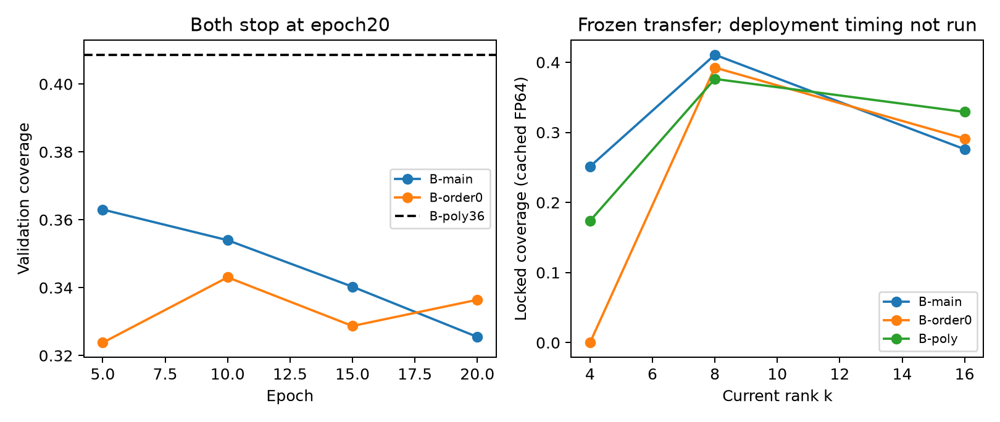
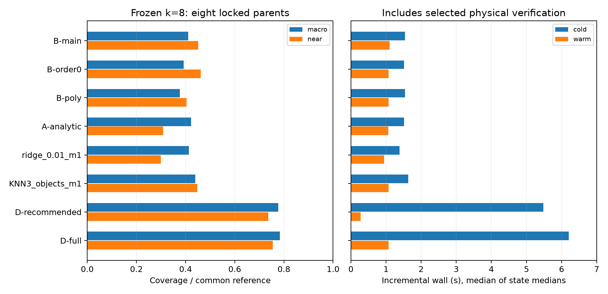
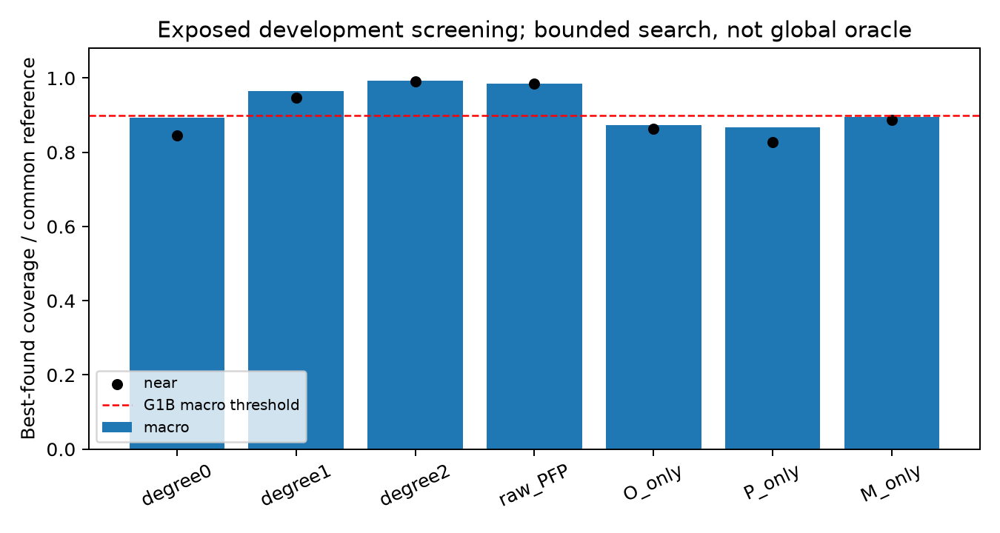

# A18_C Route B 与 A/B 集成：中文研究报告

最终科学裁决为 **NO_GO_BOTH**。这针对本轮注册的 A recipe bank 和 B 轻量学习方案；没有证明所有 current proposal 不可能。共享真实物理后端通过 G0，B 的发展集表示能力通过 G1B，但表示空间中有好方向没有转化为足够好的廉价预测。A 的共同参考表示门槛失败；两套 B 模型均在 epoch20 停止。公开归档状态与科学裁决分别记录。

## 实现与数学核验

共享接口导出 BackendProtocol、FrozenState、SeedBundle、ActionSpec、CostReceipt、VerifiedExchange。在线路线读取当前材料、残差、forcing、U/LU/SU/D、旧 step、先验和几何，不读取 full J/H、真值、teacher、旧 anchor/closure。材料采用显式多照射 real packing；材料 adjoint、L/L*、S/S*、矩阵自由 Schur、原 endpoint、gain/tau、奇异 core fallback 和 cache 失效均有独立检查。

矩阵自由 $F_{eff}=PFP+PFU(I-U^*FU)^{-1}U^*FP$ 和精确 adjoint 保留已付费的 LU。六条 O/P/M 链使用 complex128、两遍 MGS、按 degree 联合正交，默认 rank≤18、hard cap24，退化 seed 保持 inactive。每次反馈 action 仅调用一次大 L 或 L*，其他低维运算另记。B 网络固定1552→128→128，32维 outgoing，每 drop 两个 padded complex25 modes 和 no-op，共249,703参数。最高合法 logit 不高于 no-op 时返回空列表，否则至多四个合法、projectively不重复的动作；只有选中 currents 进入 verifier。

原 A17 两真实状态 G0 最大 endpoint 误差约9.14e−13，finite gain/tau保持原实现；FFT CPU/CUDA及 batched dictionary 另有实际回执。它们与 dense unit tests分别报告。新的 separated/near 两状态物理审计通过；两个 TRAIN 状态 cap-3 审计实际接受了1、2、3次，确认 configuration 更新与 root/cache重建。该审计固定材料，只改变 current subspace，不是 nonlinear transfer。见 [数学审查](MATHEMATICAL_REVIEW.md)、[新状态审计](results/shared/NEW_PILOT_PHYSICS_AUDIT.json)、[cap-3审计](results/shared/CAP3_TRAIN_IMPLEMENTATION_AUDIT.json)。

原配置 current_metric 的“whitened”沿用原命名；实际保留原Euclidean dipole-current gauge及常数cell-volume约定，白化施于数据残差，没有额外更换current metric。其余协议澄清与未测项见 [PROTOCOL_CLARIFICATIONS.json](PROTOCOL_CLARIFICATIONS.json)。

## 数据、参考与公平性

旧 A18-B 保留24/6/18划分及历史暴露标记；12-state preflight来自六个已暴露对象，仅用于 development。新 master seed2026100418一次生成48对象、每对象两状态：32 train／8 validation／8 locked test。派生配置随 parent划分；teacher共享一次生成。locked test固定 separated2、near2、geometry2、high-contrast2，其中一个 high-contrast近接触。真实全矢量 Maxwell 使用原A8/A17数值源码和既有物理参数。

初始化是围绕真值的受控局部扰动，state1由预定原始 full-GN/line-search生成；这是局部冻结状态 pilot，不能外推成未知初始化的全局反演能力。共同 reference 是原字典、A bank、连续 B及 per-core搜索所得的审计 union；continuous teacher始终称 **BEST_FOUND**，不是全局 oracle。每对象coverage先以两状态 gain总和除reference总和，再对有正reference的对象等权平均。原字典分母另报；coverage超过1表示该方法超过旧字典，不表示超过全局最优。详细来源见 [生成 manifest](assets_v002/pilot/generation_manifest.json)。

## Preflight、训练与停止

B共同参考 macro=0.993372，near=0.991263，shared-root损失=-0.004334；Tacq/D-full median=0.0425、P95=0.0446，通过G1B。负的shared-root损失来自有限搜索结果，不是它理论上支配per-core。A共同参考 macro=0.618245、near=0.518732，G1A失败；原字典口径 A=0.954421不能替代共同参考口径。

新 validation 最强无NN为B-poly36：macro=0.408635、near=0.664083，未达到.95，允许B训练。ridge/KNN只拟合32个train parents，m1/m2相同validationgain时预先选择较便宜m1。B-main最佳macro=0.363015、near=0.537764；lambda_order=0控制macro=0.343046、near=0.366950。两个模型 seed1801、相同1350s预算与35epoch上限，每5epochs FP64验证，均在20epochs因无headroom停止；每个epoch Maxwell action count为0。

J0真实20minibatches丢弃前5：CPU median1.552s，CUDA4.464s，小复矩阵路径CPU更快，故训练用nativeCPU。35是根据J0在训练前冻结的同等上限，低于原80epoch硬上限。G3 coverage分支失败，K2部署分支因强制停止未运行；没有把未测分支写成完整否证。A-MLP/GNN、B-Set、追加seeds、C训练和winner nonlinear transfer均未启动。

## 冻结测试与完整 incremental 成本

冻结模型、权重、normalizer、方法列表、B-poly36及baseline pair后才打开locked test。k=8共有16状态×8方法×5次cold/warm，共1280行实际物理测量。每状态轮换方法顺序；cold从共同固定状态开始，warm只复用同configuration已付费root/inference/records和旧full Jx，重新物化所有选中currents、endpoint以及新full Jd。D-recommended按原口径top1，其他方法top4，数量差异明确保留。

|方法|Cov共同|Cov原字典|near共同|Tacq冷(s)|Tinc冷(s)|Tinc暖(s)|
|---|---:|---:|---:|---:|---:|---:|
|A-analytic|0.4222|0.5130|0.3084|0.181|1.512|1.064|
|B-main|0.4108|0.5035|0.4517|0.216|1.541|1.101|
|B-order0|0.3924|0.4796|0.4611|0.215|1.514|1.074|
|B-poly|0.3762|0.4526|0.4043|0.231|1.537|1.069|
|D-full|0.7838|0.9874|0.7546|5.019|6.200|1.070|
|D-recommended|0.7770|0.9796|0.7370|5.021|5.478|0.278|
|control:KNN3_objects_m1|0.4389|0.5365|0.4470|0.316|1.628|1.072|
|control:ridge_0.01_m1|0.4128|0.5059|0.2992|0.221|1.388|0.945|

时间为每状态五次中位数再取跨状态中位数；Tinc包括acquisition和所有selected验证，Ttotal另包括实际共同backend/state构造。原始五次行、全部incremental operator/RHS counters和action traces保存在 [frozen_evaluation](results/frozen_evaluation) 与 [成本表](tables/locked_k8_raw_costs.csv)。初始共享state的operator快照未持久化，不能宣称已具备全部end-to-end operator分解；其wall仍计入Ttotal。current_materializations计数为原子/选中请求，不是所有batched规范化向量的内存分配次数。D完整bank与B反馈basis本身的构造成本均包含在冷Tacq。

B-main−B-poly对象级coverage差=0.034513，2000次paired parent bootstrap 95%区间[-0.028799, 0.096903]；下界≤−.02，G6 HOLD。只有8个parents；16状态/大量动作不能增加独立对象数。测试上较好的点估计不推翻validation停止决定，不选择测试表现更好的新baseline。

k=4/16使用冻结模型及rank-specific已付费reference作精确FP64小endpoint回放，Windows环境k8缓存gain与实体gain一致；这是quality transfer，不是完整部署计时。B-main macro分别为0.251275／0.276002，near分别为0.151101／0.127430。k4 order0及ridge无accepted positive gain是保留的失败结果。完整transfer Tinc、最终成像、held-out measurement质量均NOT_RUN。

## 消融、pair机制与文献

degree0/1/2 development共同macro分别.892270／.965940／.993372；rawPFP=.985400，O-only=.872960、P-only=.867877、M-only=.895436。筛选消融来自有限teacher搜索，不能把小差值解释为Schur必然优越或有统计显著性。原始记录及共同/原字典双分母见 [消融表](tables/development_ablations.csv)。

12-state×6 pair的真实rank2 joint endpoint audit：joint/reference macro=.925246，正额外gain=max(joint−singleton reference,0) macro=0；optimized joint-only state比例0。原G7的“pair机会构成reference gain≥10%”没有规定重叠分配，两个口径会给出不同判断。因此正式机制覆盖结论为HOLD，保留原输出并以[解释回执](results/preflight_review/G7_INTERPRETATION.json)限定。任意QR列投影产生的16个joint-only pairs依赖frame gauge，不能作为gate。

按scholarqa-research执行检索，429没有得到可用新结果，保留失败和全文缺口。取得的primary evidence表明[Neural Krylov](https://proceedings.neurips.cc/paper_files/paper/2024/hash/e88870ec82f2469b0ddf32c817920c68-Abstract-Conference.html)已有学习subspace／projector训练思路，[SOM-Net](https://arxiv.org/abs/2209.03567)已有学习current与解析材料更新；Wei/Chen2019 [DOI](https://doi.org/10.1109/TAP.2019.2922779)仅部分元数据核验，author PDF访问失败。不能宣称首次learned Krylov、首次projective loss或首次learned current；本轮具体组合也未获得部署支持。原创性判断限于取得证据，详见[文献与主张核验](research/literature/CODEX_NOVELTY_REVIEW.md)和[claim ledger](CLAIM_LEDGER.json)。

## 裁决、资源与失败记录

|Gate|最终状态|
|---|---|
|G0|PASS|
|G1A|FAIL|
|G1B|PASS|
|G2|PASS|
|G3|FAIL|
|G4|FAIL|
|G5|NOT_RUN|
|G6|HOLD|
|G7|HOLD|
|G8|NOT_RUN|
|G9|PASS|

共享teacher累计112.55/120min；physics bucket 14.14/60min；NN bucket（含J0、失败计时和freeze/timing）54.20/240min；nonlinear0/60min。CPU准备751.198s同时归入teacher与physics预算，是重叠归属，非第二次执行。旧wrapper误把CPU准备标为GPU占用的原记录保留，派生成本表明确分类。120s local auxiliary为保守计费上界，不冒充实测时间。J0只记录allocated VRAM82,355,712bytes；reserved peak与process RSS未测。

J6在15min硬限被终止，J7用同freeze唯一续跑完成剩余病例，合计43.44min，失败及重复工作均计费，没有重启optimizer或更改规则。T1终端numpy.bool序列化失败发生在有效原子结果写入之后；G7终端类型错误、早期background SSH失败与J6超时均保留[原始失败记录](results/raw_failures)。旧T0/T1成功action details和A0历史ID/gain重放缺失明确记录，新的冻结test有完整selected traces，不逆向补写历史。

最终 **NO_GO_BOTH**；G6统计与G7机制claim各自HOLD。保留便宜解析控制作为比较结果，但不将其重新命名为通过部署门槛的赢家。后续若研究其他feature、初始化、预算或block proposal，应新建独立预注册和未暴露test；本轮无权用locked test继续调参。

代码、报告、表图和manifests在Git；合成物理数据、checkpoint、拟合权重、缓存、依赖及原日志放Release，并核对SHA256。原许可状态保留，不擅自添加许可证或重分发论文全文。入口：[START_HERE](START_HERE.md)，重现：[REPRODUCE](REPRODUCE.md)，机器裁决：[GATE_DECISION](GATE_DECISION.json)，来源：[RIGHTS_AND_PROVENANCE](RIGHTS_AND_PROVENANCE.md)。公开归档不等于期刊录用或同行评审。
